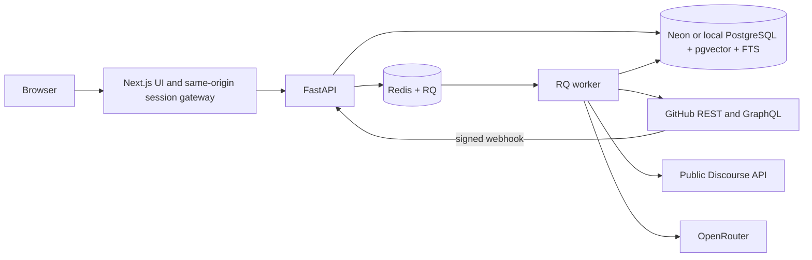

# Watermelon

Watermelon is a project-scoped engineering memory that stores original public GitHub and Discourse records, reconstructs versioned decisions from cited evidence, links decisions to code, and provides PR analysis and grounded Q&A. Its intended product behavior is evidence first: weak support leads to abstention; a source record is not itself proof that an interpretation is correct.

This repository contains a working Next.js workspace, FastAPI service, Neon/PostgreSQL schema, RQ workers, GitHub/Discourse adapters, OpenRouter inference path, PR Intelligence and Alternative Explorer, and a separate blind PEP benchmark package. Provider and App behavior still needs live credentials for full production verification; see [verification status](docs/VERIFICATION.md).

## Architecture



The longer module, trust-boundary, and data-flow notes are in [architecture](docs/ARCHITECTURE.md). The [schema guide](docs/DATABASE_SCHEMA.md) documents entities and ownership constraints. `docs/openapi.json` is the generated API contract.

## Local setup

Requirements: Python 3.13, `uv`, Node 22+, Docker Compose, and (for real AI) an OpenRouter key/model supporting strict structured output. Keep all live credentials in `.env`; `.env` and `.env.*` are gitignored. Never use a production database for local work or integration tests.

1. Copy `.env.example` to `.env`, generate a random local Postgres password plus independent `API_SERVICE_TOKEN`, `SESSION_SECRET`, and `OWNER_PASSWORD` (at least 32 characters for the two service secrets), then set both local and `DOCKER_DATABASE_*` URLs. Use a password-safe URI encoding when needed. For Neon, set pooled `DATABASE_URL` and `DOCKER_DATABASE_URL`, and direct `DATABASE_URL_UNPOOLED` and `DOCKER_DATABASE_URL_UNPOOLED` for migrations.
2. Install and start local services:

   ```sh
   uv sync --frozen
   npm ci
   docker compose --profile local-db up -d postgres redis
   uv run alembic upgrade head
   ```

3. Start API, worker, and frontend in separate terminals:

   ```sh
   uv run uvicorn backend.api:app --reload
   uv run python -m backend.worker
   npm run dev
   ```

   Open `http://localhost:3000`. For all-container local operation, configure `DOCKER_DATABASE_URL` and `DOCKER_DATABASE_URL_UNPOOLED` with the `postgres` host and run `docker compose --profile local-db --profile app up --build`; apply migrations first with `uv run alembic upgrade head` from the host or a one-shot backend container.

4. Configure GitHub App and Discourse sources using [the integration guide](docs/DEPLOYMENT.md). A repository and Discourse origin must be public. Do not add private topics or private repositories.

## Migrations and tests

```sh
uv run alembic upgrade head
uv run alembic current
uv run pytest -q
npm run typecheck
```

The PostgreSQL suite is deliberately restricted to a disposable database whose name ends in `_test`:

```sh
TEST_DATABASE_NAME=watermelon_test uv run python scripts/run_pg_integration.py
```

That script derives the test database name from `DATABASE_URL_UNPOOLED` and refuses any other database suffix. Playwright requires a running frontend/backend and valid `.env` owner credentials:

```sh
npm run test:e2e
```

See [verification results and known limits](docs/VERIFICATION.md) before treating a UI screen as a live integration.

## Blind PEP benchmark

The PEP benchmark lives under `benchmarks/`, outside the backend image. Its extractor uses the same `backend.inference.extract` pipeline as application ingestion, but receives only frozen public discussion snapshots. The evaluator reads `benchmarks/answer_keys/` only after predictions are frozen. See [benchmark instructions and rubric](benchmarks/README.md). No result is published until extraction succeeds and humans independently adjudicate matching, rationale, and source support.

## Deploy

Deploy the frontend, API, and worker as separate services. Use Neon PostgreSQL with pgvector, Redis reachable from both API and worker, a TLS reverse proxy, and environment-specific secrets. Run Alembic once against the direct Neon URL before rolling out app processes. Configure production secrets and `APP_ENV=production`; the API validates core secrets on settings load. GitHub publishing is off unless explicitly enabled and tested against an App installation. Read the [deployment checklist](docs/DEPLOYMENT.md).

## Documentation

- [System architecture and trust boundaries](docs/ARCHITECTURE.md)
- [Database entities and migrations](docs/DATABASE_SCHEMA.md)
- [API and backend behavior](docs/BACKEND.md)
- [Feature verification matrix and test report](docs/VERIFICATION.md)
