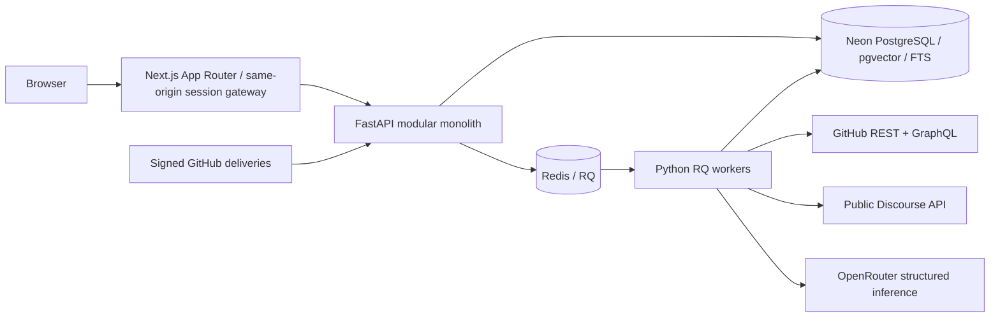

# WATERMELON architecture and implementation plan

## Scope and ordering

Build a modular monolith with asynchronous workers, starting with public repository onboarding → GitHub ingestion → versioned source storage → structured extraction → evidence checks → persisted decision → evidence-backed card. WATERMELON is the brand; ProjectRecall is the historical-memory capability. No external source text is an instruction to this application. No summaries are canonical evidence.

## Runtime topology

Next.js is a Node server, FastAPI and workers share one Python package and database. Separate processes are operational boundaries, not independent microservices. Docker Compose provides reproducible local services; Neon is the primary deployed database. Local PostgreSQL is a development/test substitute, never presented as Neon. Application connections use DATABASE_URL; Alembic uses DATABASE_URL_UNPOOLED. Secrets stay server-side.

## Modules and responsibilities

* `connectors`: public GitHub and allowlisted Discourse, bounded pagination, retries, rate limits, provenance.
* `memory`: ingestion orchestration, immutable message versions, extraction schemas, independent citation verification, interpretation revisions, feedback.
* `retrieval`: PostgreSQL full-text and pgvector candidate ranking with reciprocal rank fusion; lexical-only mode explicitly reported when embeddings are unavailable.
* `code`: explicit changed-file/commit links, Git rename inspection and selective Tree-sitter symbols. Inferred associations never promoted to verified relationships.
* `intelligence`: head-SHA-scoped PR findings, evidence thresholds, alternatives and cited Q&A. No automatic patch execution.
* `evaluation`: frozen blind inputs, separate answer keys, reproducible hashes, one-to-one adjudicated matches, precision/recall/F1 and independently scored rationale/citation support.
* `api`: project ownership, request bounds, typed errors, session-backed gateway, OpenAPI contract.

## Trust boundaries

Public-source restriction is enforced against upstream repository metadata, not only a URL shape. GitHub requests use a fixed API origin and reject cross-origin pagination. Discourse uses operator-approved HTTPS origins; redirects are disabled, DNS is checked for public addresses. No imported HTML is rendered as HTML. Source bodies go in delimited JSON data under a fixed system instruction; models have no tools or credentials. Output is untrusted until Pydantic validation and project-scoped evidence checking.

Use a signed, expiring owner session for the initial single-operator deployment. The browser never receives the API service credential; Next forwards it with a server-controlled principal. All project reads and writes verify ownership. This is an explicit MVP authentication boundary; multi-user OAuth, membership invitations, password recovery and SSO are later work. Production startup must fail without strong configured secrets. Mutating cookie-authenticated gateway requests require same origin. Webhooks use raw-body HMAC-SHA256, constant-time comparison, delivery uniqueness and bounded payload sizes. Redis enforces request limits and daily model-call budgets atomically. Missing Redis fails closed for paid inference.

## Evidence semantics

Every significant decision and alternative claim has citation objects containing immutable message-version ID and exact quote. Citation existence and quote inclusion are deterministic checks. These checks alone do **not** prove semantic entailment. Independent model verification yields supported/unsupported/uncertain; uncertainty remains needs-review, and human feedback is retained. Acceptance requires explicit disposition evidence; stars, votes, sentiment and merge status alone cannot establish it. Candidate supersession is an association until reviewed. Historical interpretations retain source revisions and model/prompt metadata.

## Schema (authoritative implementation: Alembic)

All application IDs are UUIDs. Timestamps are UTC. Source natural keys have unique constraints. Project-scoped records use indexed project foreign keys; access is filtered at the API boundary. Revision snapshots are immutable. JSONB stores raw upstream payloads and bounded structured metadata, not substitutes for normalized relationships.

| Table | Key fields / constraints |
|---|---|
| projects | owner_id, repository, name, status; unique owner/repository |
| source_connections | project FK, provider, origin, external_id, cursor, last_sync, status; unique project/provider/origin |
| contributors | provider, external_id, handle, profile_url; unique provider/external_id |
| identity_links | contributor FKs, public proof URL, review status; never style-based |
| discussions | project/source FKs, external_id, kind, title, URL, timestamps; unique connection/external_id |
| messages | project/discussion/contributor FKs, external_id, URL, parent FK; unique discussion/external_id |
| message_versions | message FK, content SHA256, body, raw payload, source updated_at, observed_at; unique message/hash |
| decisions | project/discussion FK, stable extraction key, current version counter; unique discussion/key |
| decision_versions | decision FK, revision, title, claim, scope, disposition, verification, model/prompt/input hashes, created_at; unique decision/revision |
| alternatives | decision version FK, approach, disposition, rationale |
| evidence_references | decision version FK, optional alternative FK, message version FK, claim, exact quote, verification |
| code_entities | project FK, path, symbol, kind, commit SHA; unique project/path/symbol/SHA |
| code_links | decision version FK, code entity FK, provenance, verified/inferred/stale, proof URL |
| graph_edges | project FK, source/target kind and IDs, relation, provenance; unique project/source/target/relation |
| embeddings | project FK, decision version FK, model, content hash, vector(1536); unique version/model; cosine HNSW |
| pull_requests | project FK, number, title, URL, head SHA, state, raw diff metadata; unique project/number |
| pr_findings | PR FK, head SHA, decision version FK, relevance, explanation, publication state; unique PR/SHA/version |
| ai_suggestions | finding FK, model, approach, tradeoffs, constraints, untested=true |
| chat_sessions | project FK, owner_id, created_at |
| chat_messages | session FK, role, body, citation snapshots, model, created_at |
| ingestion_jobs | project FK, kind, status, progress, sanitized error, cursor, attempts, timestamps |
| webhook_deliveries | delivery ID unique, event, payload hash, payload, status, received_at |
| feedback | project/version FK, actor, category, comment, created_at |
| evaluation_datasets | name/version unique, input manifest/hash, answer-key hash, split |
| evaluation_runs | dataset FK, model, prompt version, input/output hashes, configuration, metrics, status |

Full-text GIN index on decision title/claim via immutable English `to_tsvector`; vector search indexes version embeddings. Foreign keys preserve evidence; no cascading source deletion. Migration downgrade is explicitly destructive and operator-only.

## API contracts

FastAPI `/openapi.json` is the typed source; generate frontend types using `openapi-typescript`. Errors: `{error: {code, message, request_id}}`. Lists: `{items, total, limit, offset}`. Limit 1–100. Authentication failures 401, forbidden project access 404, validation 422, upstream failures 502/503, throttling 429.

| Method / endpoint | Input → output |
|---|---|
| POST /v1/projects | `{repository: owner/repo}` → Project; upstream public check |
| GET /v1/projects | → owned Project page |
| GET /v1/projects/{id} | → Project and real aggregate counts |
| POST /v1/projects/{id}/ingest | bounded source options → persisted Job (202) |
| GET /v1/projects/{id}/jobs | → Job page; includes blocked/failed/partial |
| GET /v1/projects/{id}/decisions | status/query/limit/offset → Decision page |
| GET /v1/projects/{id}/decisions/{id} | → current interpretation, alternatives, immutable citations, revisions |
| POST /v1/projects/{id}/decisions/{id}/feedback | category/comment → Feedback |
| GET /v1/projects/{id}/discussions[/{id}] | → discussions / source messages with revisions |
| GET /v1/projects/{id}/search | query → ranked results and retrieval mode |
| GET /v1/projects/{id}/{graph,timeline,code,pull-requests,integrations} | → actual stored entities/status |
| POST /v1/projects/{id}/discourse | approved origin/topic → ingestion job |
| POST /v1/projects/{id}/ask | question/optional session_id → cited answer/abstention |
| POST /webhooks/github | signed raw body → delivery acceptance, replay-safe |
| GET /v1/benchmark[/runs/{id}] | → actual dataset/run metadata; no invented scores |
| GET /health | liveness only; readiness separately checks DB/Redis |

Routes not yet implemented return explicit availability states; they must not imply completion.

## Prioritized milestones and success criteria

1. **Foundation:** dependency locks, local services, schema migration, authenticated API, consistent UI shell, loading/error/empty states. Pass typecheck, Python security tests, migration upgrade and clean production build.
2. **First vertical slice:** onboard a real public repository, persist original messages/revisions, enqueue ingestion, extract with configured OpenRouter, validate citations, render persisted cards. Repeat ingestion adds no duplicate records; edits create revisions; fake citations fail. Live extraction cannot be certified without a configured model key.
3. **Discourse and retrieval:** full topic post-stream retrieval, strict origin checks, source revisions, FTS and optional embeddings. Demonstrate retrieval against real stored evidence; distinguish lexical fallback.
4. **Code awareness and graph:** exact PR file/commit references, Git rename tests, Python/TypeScript symbol parser, provenance-labelled interactive graph and timeline. No broad repository code execution.
5. **PR intelligence:** signed App delivery, durable enqueue/recovery, unique head-SHA findings, stale head recheck, insufficient evidence silence, one updatable cited comment only with explicitly enabled publishing. Test actual App separately from HTTP mocks.
6. **Blind PEP benchmark:** immutable input manifests without PEP rejected-ideas text, isolated answer keys, explicit human adjudication, repeatable scorer. A score is publishable only with dataset hashes and grading evidence; synthetic fixtures validate mechanics only.
7. **Q&A and alternatives:** project-scoped hybrid retrieval, citation validation, abstention, saved history, quotas, provider errors; 2–3 visibly untested suggestions grounded in constraints. Streaming only after validation or as clearly provisional events.
8. **UX and hardening:** all requested routes, keyboard/mobile use, scoped reduced-motion GSAP, Playwright flows, operational backups, health probes, reconciliation, deployment runbook and explicit readiness report.

## Integration dependencies

Neon organization/project selection and development branch; pooled/direct URLs. GitHub public REST can operate without a token at low limits; Discussions require a token and enabled repository Discussions. GitHub App needs app ID, private key, installation ID, webhook secret and selected public repositories (read metadata/issues/contents/discussions, PR write only if publication is enabled). OpenRouter needs an operator-configured key, extraction and verification model IDs, budget and embedding model/dimensions. Discourse defaults to discuss.python.org; adding origins requires operator configuration. No token is requested in chat or sent to the browser.

## Documentation verified before implementation

* Next.js App Router installation: https://nextjs.org/docs/app/getting-started/installation
* Next.js deployment: https://nextjs.org/docs/app/getting-started/deploying
* GSAP React scoped cleanup: https://gsap.com/resources/React/
* OpenRouter structured outputs: https://openrouter.ai/docs/guides/features/structured-outputs
* GitHub timeline: https://docs.github.com/en/rest/issues/timeline
* GitHub webhook verification: https://docs.github.com/en/webhooks/using-webhooks/validating-webhook-deliveries
* RQ queues and retries: https://python-rq.org/docs/
* Discourse API: https://docs.discourse.org/

Package versions are resolved from registries and locked during setup; APIs are validated with contract tests. External credential-dependent behavior is reported independently of mocked tests.
