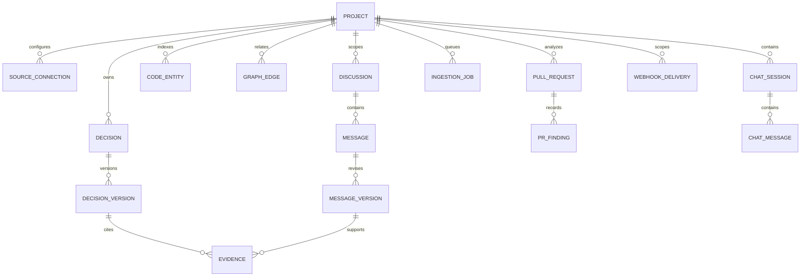

# Database schema

PostgreSQL migrations in `migrations/versions/` are the schema source of truth. `ac05005a2b7d` creates the canonical entities; `8b91d1c7a04f` adds graph/job invariants; `3fa17d42a910` adds chat token/cost usage. The initial migration installs `vector` where the server supports it. Use the direct/unpooled database connection for Alembic.

## Entity map



| Table | Purpose and key integrity rules |
|---|---|
| `projects` | Owner-scoped repository workspace; unique repository per owner. |
| `source_connections` | Provider configuration, source origin, sync watermark and cursor; scoped to project. |
| `discussions` | Issue, PR, GitHub Discussion, or Discourse topic; provider/external IDs unique within source. |
| `contributors`, `identity_links` | Source authors and explicitly linked identities; provider IDs unique within project/source scope. |
| `messages`, `message_versions` | Stable source message identity plus immutable revisions, timestamps, author and content hash; duplicate versions are idempotent. |
| `decisions`, `decision_versions` | Stable deduplication identity and append-only interpretations/status revisions; only a current revision is authoritative. |
| `evidence` | Many-to-many link from decision version to immutable message version with exact quoted excerpt. |
| `alternatives` | Rejected, deferred, considered, or accepted design options attached to a specific decision version. |
| `embeddings` | Vector representation associated with project-scoped evidence/interpretation, used only as retrieval ranking. |
| `code_entities` | File/symbol and commit/PR links, labeled verified, inferred, or stale. |
| `code_links` | Provenance-labeled associations between code entities and decision/evidence records. |
| `graph_edges` | Typed, project-scoped edges with endpoint kind, unique identity, no self-edges. |
| `pull_requests`, `pr_findings` | Current head and diff metadata, analyzed head SHA, cited finding and publication state. |
| `ai_suggestions` | Decision-aware recommendations with validation state; untested options remain unvalidated. |
| `ingestion_jobs` | Durable queue state, cursor, progress, bounded errors, attempts and timestamps. |
| `webhook_deliveries` | Unique delivery ID and payload hash for replay protection. |
| `chat_sessions`, `chat_messages` | Owner/project-scoped conversation, answer citations, prompt/completion tokens, provider cost when reported. |
| `evaluation_datasets`, `evaluation_runs` | Dataset manifest/hash and run metadata/metrics; application API exposes recorded rows only. Blind benchmark keys stay outside this database/runtime path. |
| `feedback` | Owner-scoped reviewer feedback tied to an interpretation version. |

Foreign keys preserve provenance. Project filters are applied in repositories/routes; unique source IDs and content hashes prevent duplicate import. JSONB stores upstream raw payloads and bounded job cursors. Full-text indexes and optional pgvector indexes accelerate hybrid retrieval. Similarity values are rank signals, never correctness probabilities.

## Commands

```sh
uv run alembic upgrade head
uv run alembic current
uv run alembic check
```

For test database setup see [backend setup](BACKEND.md). Downgrades can discard constraints or data and require operator review.
